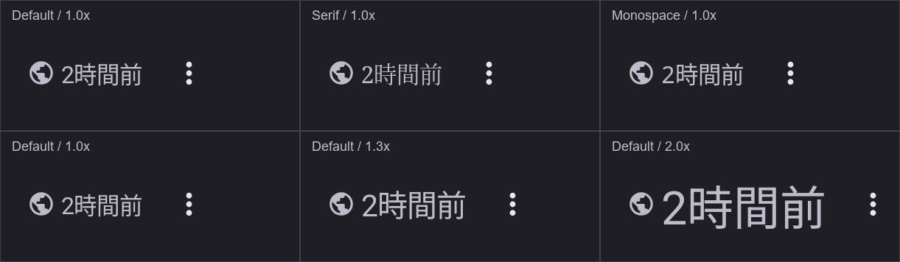
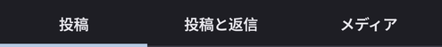
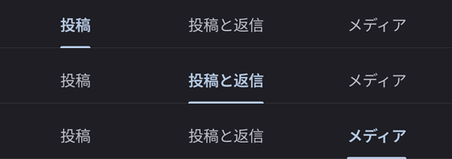

# UI変更履歴と本体への移植

2026-10-11時点の記録。**現在のUI変更はすべて本体へ未適用**。試作での表示方針を決めた項目も、本体への採用・移植が完了したことを意味しない。本体への反映は、別途依頼があってから行う。

本体の現行仕様は[UI・機能仕様](../docs/ui-guidelines.md)、試作の再現範囲は[README](README.md)を参照する。この文書は試作との差分と移植の参考資料として扱う。

## 移植後の記載整理

本体への移植と必要な動作確認が完了した項目は、この文書の差分表・調整履歴・詳細説明から該当箇所を削除する。「適用済み」の項目を残し続けず、未適用の変更を参照する文書として維持する。一部だけ移植した場合は、残る差分と未確認事項を残す。

READMEの対応する差分記載も削除し、参照がなくなった比較画像を削除する。移植内容・適用日・確認結果はPRまたはコミットの説明に記録し、過去の記載はGit履歴で参照する。本体の仕様・手順が変わる場合は、対応する現行文書を更新する。

## 現在の差分と適用状況

| 項目 | 本体の基準 → 現在の試作 | 本体への適用 |
| --- | --- | --- |
| 投稿ヘッダーの公開範囲アイコン | 12 dp → 14.4 dp。時刻・三点メニューとの中央揃えを維持 | **未適用** |
| プロフィールの投稿タブ | 標準48 dp → 最小44 dp。文字拡大・折り返し時は高さを広げる | **未適用** |
| プロフィール・探索・検索結果・通知タブの選択表示 | タブ幅の下線・共通の文字表現 → 文字幅の2 dp下線と選択色・太さの切替を共通化。高さ・文字サイズ・余白・区切り線は各画面の指定を維持（プロフィールの下部区切り線は0.5 dp） | **未適用** |
| プロフィール欄とタブの境界線・間隔 | 下端の区切り線を削除し、プロフィール欄の下余白を8 dpから4 dpへ変更 | **未適用** |
| 添付画像の開閉遷移 | Dialogによる全画面表示 → サムネイルから拡大し、閲覧中の画像のサムネイルへ戻る遷移 | **未適用** |
| 画像操作の競合回避 | 試作では下ドラッグ中の2本指への切替で閉じる操作を中止し、ピンチへ引き継ぐ | **未適用** |
| 遷移中の背面画面・表示領域の保持 | 試作では遷移中のInsetsを固定し、非表示タブの最後の表示領域を保持 | **未適用** |

固定ダークテーマ、固定投稿・画像、空の検索・通知一覧、通信・認証・保存の代替処理は試作環境の制約であり、本体への移植対象に含めない。プロフィールURLのリンク表示もプロフィール欄の表示確認用であり、本体への移植対象に含めない。元々本体と共通の動作も「新しい変更」とは扱わない。

## 今回の調整履歴

以下の調整・比較は2026-10-11に実施した。以前からある画像遷移などの実験については、この文書では変更日を特定せず、現在残る差分として記録する。

| 順序 | 調整・比較 | 現在の扱い |
| --- | --- | --- |
| 1 | 公開範囲アイコンの12 dp、時刻の12 sp、三点メニューの18 dpを確認 | 本体の基準値 |
| 2 | 公開範囲アイコンを14.4 dpに変更し、フォント・文字倍率の差を確認 | 試作に保持。本体へ未適用 |
| 3 | 描画の下端を揃える案を比較 | 比較画像のみ。コードに採用せず、中央揃えを維持 |
| 4 | プロフィールタブを最小40 dpで試行 | 44 dpへ変更済み。40 dpは移植しない |
| 5 | プロフィールタブを最小44 dpに変更 | 試作に保持。本体へ未適用 |
| 6 | 本体への反映を保留 | 一時的に本体へ加えた今回の変更を取り消し、試作だけに保持 |
| 7 | 参考記事のテキスト主体のタブと選択インジケーターを試行 | 文字幅の下線と選択色・太さの切替を試作に保持。本体へ未適用 |
| 8 | プロフィール欄とタブの境界線を削除 | 試作に保持。本体へ未適用 |
| 9 | プロフィール欄の下余白を8 dpから0 dpへ変更し、タブを8 dp近づける | 4 dpへ調整済み。0 dpは移植しない |
| 10 | プロフィール欄とタブの間に4 dpの余白を設ける | 試作に保持。本体へ未適用 |

## 公開範囲アイコン・時刻・三点メニュー

対応する[試作のStatusCard.kt](src/main/java/io/github/ponpokoo/mastodonclient/feature/status/StatusCard.kt)と[本体のStatusCard.kt](../app/src/main/java/io/github/ponpokoo/mastodonclient/feature/status/StatusCard.kt)を比較する。

移植する変更は、`statusVisibility(status.visibility)`で選んだアイコンの`Modifier.size(12.dp)`を`Modifier.size(14.4.dp)`へ変更する箇所。公開以外の公開範囲にも同じサイズ指定が適用される。

| 部品 | 試作の値・配置 |
| --- | --- |
| 公開範囲アイコン | 14.4 dp |
| アイコンと時刻の間隔 | 3 dp |
| 時刻 | `bodySmall`：12 sp、行高18 sp。相対時刻の計算・表示形式は変更しない |
| 三点メニューのアイコン | 18 dp、ボタンの操作領域48 dp |
| ヘッダー内の配置 | 高さ48 dpの行で`Alignment.CenterVertically` |

アイコンの外枠を同じサイズにする変更ではなく、描画される図形の高さを近づける調整。24単位のパスに対し、Publicは高さ20、MoreVertは高さ16なので、14.4 × 20/24と18 × 16/24はともに12 dpになる。ほかの公開範囲アイコンの形状まで同じ描画高になることは保証しない。



確認環境はAndroid 17エミュレーター、密度420 dpi（2.625 px/dp）。「2時間前」の描画高は通常倍率で公開アイコン32 px・時刻30 px・メニュー31 pxだった。Default／Sans／Serif／Monospaceの4種類で通常倍率の高さは同じで、数字の形は異なった。文字倍率1.3・2.0では時刻が39・59 pxとなり、アイコンのサイズは変わらない。中央位置の差は各条件で最大0.5 pxだった。通常倍率のライトテーマでも同じ高さを確認した。

端末メーカー独自のフォント、長い時刻表示、公開以外のアイコンの見た目は未確認。本体へ移植するときは、それらと文字拡大時の重なり・省略、メニューの操作領域も確認する。

## プロフィールの投稿タブ

対応する[試作のProfileContent.kt](src/main/java/io/github/ponpokoo/mastodonclient/feature/profile/ProfileContent.kt)と[本体のProfileContent.kt](../app/src/main/java/io/github/ponpokoo/mastodonclient/feature/profile/ProfileContent.kt)を比較する。

移植する場合は次の変更を一緒に反映する。

- `TextAlign`のimportを追加する。
- `tabRowHeight`の初期値を48 dpから44 dpへ変更する。
- `Tab(text = { Text(label) })`をコンテンツ形式の`Tab { Text(...) }`にし、`Modifier.heightIn(min = 44.dp)`を指定する。標準のテキスト形式のタブは48 dpになるため、数字だけの変更では足りない。
- タブの文字には左右16 dp・上下8 dpの余白、`MaterialTheme.typography.titleSmall`、`TextAlign.Center`を指定する。文字14 sp・行高20 spを維持する。選択表示は下記の共通部品`PrototypeTabText`で適用する。
- タブ行の`onSizeChanged`による実際の高さの取得、選択処理、テストタグ、スワイプ・スクロール連携は維持する。試作では`PrototypeTabRow`が内部の`SecondaryTabRow`へ計測用のmodifierを渡す。



44 dpは最小値であり、固定高ではない。文字拡大や折り返しで必要な高さを確保し、計測した高さを投稿領域の計算に使う。

40 dpの試行時には文字倍率1.0／1.3／2.0で高さ40.0／約43.05／約91.05 dpとなり、文字の収まりとタップ・左右スワイプを確認した。2.0では「投稿と返信」が折り返した。投稿操作がプロフィールとタイムラインで共有される既存端末テストも成功した。

44 dpへの高さ変更時にはビルドと通常倍率の表示を確認し、実際のタブ行は116 px（約44.19 dp、ピクセルへの丸めを含む）だった。40 dpでの確認を、44 dpでの確認済み結果として扱わない。選択表示の変更後の確認は下記に記録する。

### テキスト主体の選択インジケーター

[Solusの参考記事](https://solus.co.jp/blog/using-tabs-for-intuitive-app-design)のテキスト主体の例と、下線・文字色による選択表示を参考にする。記事の寸法はpx表記だが、この試作では下線2 dp・区切り線0.5 dpを採用する。文字サイズは既存の14 spを維持する。

- `SecondaryTabRow`の`indicator`に`TabRowDefaults.PrimaryIndicator`を指定する。共通部品で実際に描画する文字幅を計測し、タブ中央に合わせて位置・幅をアニメーションする。Materialの最小幅24 dpを維持する。Materialの`matchContentSize`は左右16 dpの余白を前提に幅を推定するため、左右4 dpの探索タブにはその推定を使わない。
- 下線は高さ2 dp、色はテーマの`primary`、上部の角丸は2 dp。タブ全体を等分する配置は維持する。
- 選択中の文字は`primary`とSemiBold、未選択は`onSurfaceVariant`とNormal。文字色だけに頼らず、下線と太さでも選択状態を示す。
- 下部区切り線は`outlineVariant`で0.5 dp。高さ44 dpと文字拡大時の折り返しを維持し、記事の1行表示の説明を理由に文字を切り詰めない。

下線と文字色・太さは[PrototypeTabs.kt](src/main/java/io/github/ponpokoo/transitionprototype/PrototypeTabs.kt)の`PrototypeTabRow`・`PrototypeTab`・`PrototypeTabText`にまとめ、プロフィール、探索の初期一覧、検索結果、通知で共用する。`PrototypeTab`はMaterialの文字色の切替アニメーションを維持する。共通化するのはこの選択表示だけで、文字サイズ・余白・最小高さ・折り返しは呼び出し側に残す。探索の初期一覧は既存の`labelMedium`・左右4 dp／上下14 dp・1行表示を維持し、検索結果と通知は既存のテキスト形式の`Tab`を維持する。プロフィールの44 dpと0.5 dp区切り線を他の画面には適用しない。

移植時は共通部品を本体の共通UIへ移し、`ProfileContent.kt`・`ExploreContent.kt`・`SearchContent.kt`・`NotificationsContent.kt`の呼び出しを一緒に反映する。試作namespaceへのimportは本体の配置に合わせる。各画面の`Tab`、テストタグ、選択処理、タップ、スワイプ、選択タイミングの処理は維持する。



変更後の試作ではDebugビルドと、Android 17エミュレーターでの文字倍率1.0／1.3／2.0の表示・タップ・左右スワイプを確認した。タブ行の高さは116／116／239 px（約44.19／44.19／91.05 dp）。各ラベルがタブ内に収まり、通常倍率の3つの選択状態で下線の幅・位置と文字色・太さを確認した。確認用の一時テストは作業後に削除した。本体での表示・操作、メーカー独自フォント、ライトテーマは未確認。

### プロフィール欄とタブの境界線

プロフィール欄の下端、`stickyHeader(key = "profile_tabs")`の直前にある`HorizontalDivider()`を削除する。さらにプロフィール情報を囲む`Column`の下余白を8 dpから4 dpへ変更し、タブを本体より4 dp近づける。左右16 dp・上8 dpの余白、タブの最小44 dpと内部余白は維持する。項目のないプロフィールにも同じ下余白を適用する。タブ下部の0.5 dp区切り線と選択インジケーターも維持する。移植対象は同じ`ProfileContent.kt`の区切り線と`Column`の余白指定。

項目欄とタブの間隔を確認するため、試作の固定プロフィールに「Webサイト」「X」の項目を追加する。項目表示は既存の表示コードを使い、項目欄自体の余白は維持する。確認用の項目・URLは本体への移植対象外。

## 以前から残る画像遷移などの差分

詳細な挙動は[READMEの画像遷移](README.md#復元した画像遷移)と[再現範囲](README.md#再現範囲)を参照する。いずれも本体へ未適用。

- 開く遷移は350 ms。閉じるときは拡大・移動・下ドラッグを150 msで戻し、角丸を110 msで付けてからスプリングでサムネイルへ戻る。画像切替後の戻り先と、開く途中の戻る操作も含む。
- 実装の入口は[PrototypeImageTransition.kt](src/main/java/io/github/ponpokoo/transitionprototype/PrototypeImageTransition.kt)と[PrototypeApp.kt](src/main/java/io/github/ponpokoo/transitionprototype/PrototypeApp.kt)。`StatusCard.kt`、画像ビューア、画面のInsetsにも接続箇所がある。
- 本体へ採用するときは、本体の画面構成に合わせて接続し直す。固定Repositoryや試作専用namespaceへの依存をそのまま移さない。今回のアイコン・タブの寸法変更と、画像遷移の採用は個別に判断する。

画像関連には[試作の端末テスト](src/androidTest/java/io/github/ponpokoo/transitionprototype/PrototypeImageTransitionDeviceTest.kt)があるが、この記録の作成時には再実行していない。本体での画像読込、画面離脱、戻る操作、操作中断、システムバーとスクロール位置、フレーム性能は移植後に別途確認する。

## 本体へ移植するときの手順

1. 採用する項目を決め、この文書の「未適用」を維持したまま移植に着手する。本体と試作の最新版を確認する。
2. リポジトリ直下で以下を実行し、本体の更新と試作との差分を確認する。

   ```powershell
   python ui-prototype/import-production-ui.py --check
   python ui-prototype/import-production-ui.py --diff
   ```

   `--check`の成功は移植完了やUIの一致を意味しない。`ADAPTED`は試作が取り込み基準と異なることを示す。`--refresh`は本体から試作へ取り込む操作であり、本体へ移植するコマンドではない。
3. 選んだ差分だけを本体へ反映する。特に`StatusCard.kt`には以前から画像遷移の接続があるため、アイコンの移植時にファイル全体を上書きしない。リソースが必要な変更では本体のnamespaceに合わせる。
4. [開発ガイド](../docs/project-setup.md)に従って変更範囲のビルド・テストを実施する。寸法変更では本体のタイムライン・投稿詳細・自分と他者のプロフィール、ライト／ダーク、文字倍率1.0／1.3／2.0を確認する。プロフィールはタップ・スワイプ・選択状態・各タブのスクロール位置・ヘッダーとの連携を確認し、[ProfileTabSwipeDeviceTest](../app/src/androidTest/java/io/github/ponpokoo/mastodonclient/ProfileTabSwipeDeviceTest.kt)と[ProfileScrollDeviceTest](../app/src/androidTest/java/io/github/ponpokoo/mastodonclient/ProfileScrollDeviceTest.kt)から影響するテストを選ぶ。
5. 本体での動作確認後、移植内容・適用日・確認範囲をPRまたはコミットの説明に記録し、[移植後の記載整理](#移植後の記載整理)に従って該当箇所を削除する。残る項目は「未適用」のままにする。
6. 本体と試作の対応を確認したファイルについて、取り込み基準を更新する。今回の寸法変更なら以下の2ファイルが対象になる。

   ```powershell
   python ui-prototype/import-production-ui.py --record app/src/main/java/io/github/ponpokoo/mastodonclient/feature/status/StatusCard.kt --record app/src/main/java/io/github/ponpokoo/mastodonclient/feature/profile/ProfileContent.kt
   ```

   `--record`は本体のハッシュを記録するだけで、コピー・マージ・テストを行わない。画像遷移など未適用の差分が残れば、記録後も`ADAPTED`が表示される。

完了とする条件は、選んだ変更が本体に入り、本体の画面・データと組み合わせた確認を終え、残る差分と未確認事項を区別できること。試作の確認だけで本体への適用済みにはしない。
